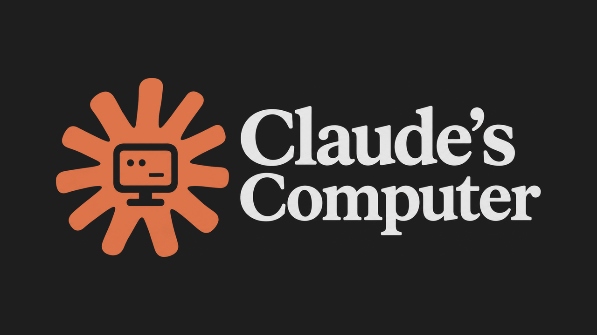
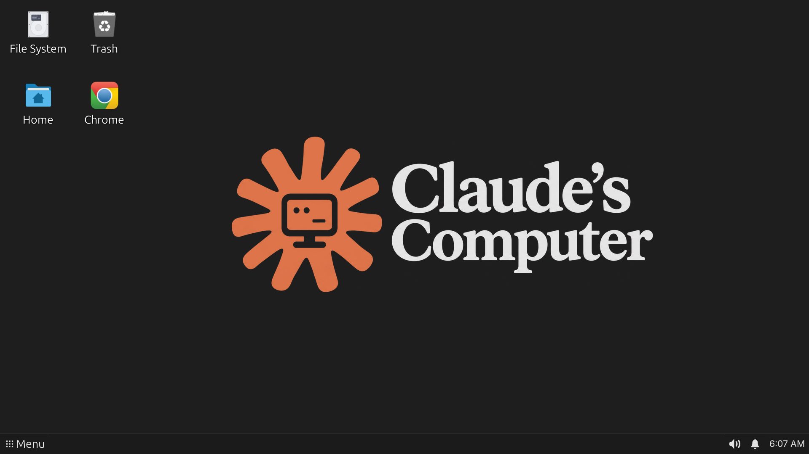
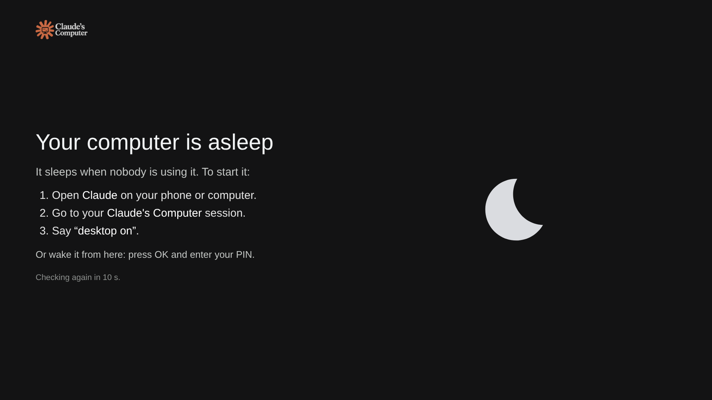

# Claude's Computer

## Your TV is your desktop computer now. All it takes is your Claude subscription.



Every Claude Code session on the web comes with its own computer. This Android TV app makes it yours, on your TV,
as a full desktop: Chrome, documents, files, sound, and Claude right there to set things up and
fix them. Walk to the TV in another room and it's the same desktop, right where you left
it. No PC to buy, no extra monthly bill. Plug in a cheap keyboard and mouse.

**Alpha build.** It works, it isn't finished, and things will break. Free and open source, built by one person.
**[☕ Tip jar](https://ko-fi.com/stuckdrew)**: if it's useful to you, tips keep it going.

> **Unofficial.** Not made by, affiliated with, or endorsed by Anthropic. "Claude" and "Claude Code" are Anthropic's
> trademarks, used here only to say what this works with.



## Quick start

```
1. TV         Install the app (Downloader app, then the link from Releases). Open it, scan the QR code with
              your phone and sign in to Tailscale (free; you can make the account right there).
2. Claude     Fork this repo. On claude.ai/code, start a session on your copy (network: Full). Type:

                  desktop on

              Open the sign-in link Claude gives you and approve the computer.
              The desktop opens on the TV by itself.
3. Then       Tailscale: approve the TV's "exit node" and "home network" in the admin console.
              Claude: say "set up the helper" (updates and repairs without touching the TV).
```



## What you need

- An **Android TV or Google TV**. Samsung and LG can't run Android apps: plug in a Google TV stick.
- A **keyboard and mouse**: cheap ones are fine. USB plugs into the TV; Bluetooth pairs in its settings.
- A **phone**, a Claude plan with **Claude Code on the web**, a **GitHub** account and a free **Tailscale** account.

## Set it up (about 15 minutes)

**On the TV.** Install **Downloader** (by AFTVnews) from the TV's store and let it install apps (Settings → Apps →
Security & restrictions → Unknown sources). In Downloader, open
`github.com/claudes-computer/claudes-computer/releases/latest/download/claudes-computer.apk`
(always the newest; also on the [Releases](../../releases) page).
Open **Claude's Computer** and scan the QR code: it opens Tailscale's sign-in on your phone, where you can also make
the account. Connect the keyboard and mouse.

**In Claude** (phone or computer). Press **Fork** on this page. On [claude.ai/code](https://claude.ai/code), connect
GitHub when asked, set the environment's **Network access** to **Full** (environment menu at the top of the session
→ Edit), start a session on your fork and type **desktop on**. The first time takes about 3 minutes and ends with a
Tailscale sign-in link: open it and approve. The desktop opens on the TV by itself. Rename the session
**Claude's Computer** so you can find it again. Sonnet is a good model for this session.

**Then, in Tailscale.** In the [admin console](https://login.tailscale.com/admin/machines), open the TV (`ccrd-tv`) →
**Edit route settings**, and turn on **use as exit node** and your **home network**. The computer then browses
through your home internet, and Claude can reach your home network when you ask it to.

**Then, in Claude.** Say **set up the helper**. Claude tells you what to press on the TV; the table under
[Permissions on the TV](#permissions-on-the-tv) says what each permission is for.

## Using it

- **Waking it:** the computer sleeps when nobody is watching. Say **desktop on** in your session; the TV opens the
  desktop by itself. To wake it from the TV without a phone, ask Claude to "set up waking from the TV" (a 4-digit PIN).
- **Claude is the handyman.** It installs and fixes things when you ask in your session. It isn't watching while you
  use the desktop. For a real repair, switch the chat to Opus (model menu next to the message box).
- **Updating the TV app:** ask Claude to "update the TVs". The new version travels to every TV that's on. With the
  helper set up (below) it installs and reopens by itself; otherwise Android asks on the TV: move to **Install**, OK.
- **Music keeps playing** when you leave the app for the TV's home screen, until another app plays sound.
- **Two workspaces:** the switch in the bar flips between **Yours** and **Claude's**. Claude works in its own, so it
  never takes over your screen; peek in any time.
- **Extras** (ask Claude): back up your files to Google Drive, keep your browser logins (encrypted), a home network
  check-up, use the desktop from a laptop or phone.

## Permissions on the TV

Ask Claude to "set up the helper". Claude leads: it requests each permission this TV supports, skips the ones it
doesn't, tells you what to press, and lists at the end what this TV can and can't do. On Android 11 or newer it asks
for wireless debugging (5) right after the helper is installed, because with it Claude grants 3 and 4 itself.

| Permission | What it does, and why it's needed | Available on |
|---|---|---|
| **1. Install unknown apps** (for Claude's Computer) | Lets the app install its own updates and the helper app. Android requires this for any app that installs apps outside the Play Store. | All Android TV and Google TV |
| **2. Install the helper app** | A second, small app that keeps working while the main app updates or isn't running. Needed because an app can't press buttons or reopen itself during its own update. | All Android TV and Google TV |
| **3. VPN connection** (for the helper) | Creates a local network interface inside the helper. The TV accepts remote-control commands only from other devices; this interface lets the helper's commands reach the TV as if from another device. No traffic leaves the TV. | All Android TV and Google TV |
| **4. Pair the helper as a remote** (6-character code on the TV) | Authorizes the helper as a remote control. With 1–4, Claude can turn the TV on and off, press any button and install updates without anyone pressing Install, and the helper reopens the app after an update or a crash. | TVs with the Google TV remote service (most Android TV and Google TV; if the TV pairs with the Google TV app on a phone, it has it) |
| **5. Wireless debugging** (Developer options → Wireless debugging → Pair device with pairing code) | Gives Claude a command line on the TV: silent installs, system settings, screenshots of any app, logs, and turning off preinstalled apps or ads you choose (every change is listed and can be undone). Turns off when the TV restarts; turn it on again in Settings, no new pairing. | Android 11 or newer |

Without the helper, everything else works; updates then need someone to press Install on the TV.

## Experimental

These work, but they're rougher, and nothing here is needed. Ask Claude for any of them and it walks you through.

- **Speeding it up.**
  - **Smoother or sharper picture:** ask Claude to change the stream (frames per second, quality, codec).
  - **The house's fast lane:** the TV can carry the connection itself through your router, instead of a relay far
    away. It tries this on its own when the router allows it (NAT-PMP, which many routers have off).
  - **No Tailscale sign-in on a fresh computer:** ask Claude to "skip the sign-in next time".
- **The TV's microphone** on the desktop: **Ctrl+Alt+M** turns it on and off (a badge shows while it's on).

**Coming soon:** more than one computer, managed from the TV: start a new one, name it, archive it, switch between
them.

## It's Claude's house

This computer is Claude's house, and you're living in it. Be at home, and know the house rules:

- **Claude only comes when you call.** It acts only when you send a message in your session. It isn't watching
  you, and nothing runs in between except the timer that puts the computer to sleep.
- **There are no locked doors.** When you call, Claude can go into any room: every file, the browser, the screen.
  Keep anything you wouldn't hand to a helper somewhere else.
- **Everything it does is written down.** Every command Claude runs is in your session's chat. Scroll up to see it.
- **The TV shows it.** Whenever Claude looks at the TV's screen, sends the app an update or checks your home
  network, the TV shows a notice for a few seconds, like a camera's light.
- **It's Anthropic's computer.** It runs on Anthropic's servers under their
  [usage policy](https://www.anthropic.com/legal/aup), the same as any cloud computer. You're responsible for what
  you do on it. (Claude isn't watching you, but it's Claude's house: you can't hide anything from Claude on it.)

## Privacy

No analytics, no tracking, no servers of ours. The TV and the computer talk over your own Tailscale network
(Tailscale's log uploads are off). The computer downloads its software from the usual places when it's set up.
Waking from the TV calls `api.anthropic.com`; Drive backup goes to your Drive. What you ask Claude to look at becomes
part of your Claude conversation.

## Fair use

One household, your own account and plan limits. The machine stays awake only while someone is watching, and sleeps
about 10 minutes after the last viewer leaves. A session can be replaced with a fresh machine; back up what matters.

## Troubleshooting

| What you see | What to do |
|---|---|
| "Your computer is asleep" | Say "desktop on" to Claude. |
| "Connect this TV" again | Scan the code again. |
| The app won't open (it just beeps) | Restart the TV. Still won't? Install the newest `.apk` over it with Downloader. |
| Choppy picture | Slow Wi-Fi or a busy relay. Try another network. |
| The bottom bar is cut off | The TV zooms in a little ("overscan"): set its picture size to **Full pixel** / **Just scan**. |
| Anything else | Tell Claude what you see, in Opus for a real repair. |

## Ideas, bugs and tips

- **Something broken, or an idea:** open an [issue](https://github.com/claudes-computer/claudes-computer/issues/new/choose).
  Pick "Bug" or "Idea" and say what you saw or what you'd like. There's no promise of a reply, but every one gets read.
- **[☕ Tip jar](https://ko-fi.com/stuckdrew):** if it's useful to you, tips keep it going.

## Built by

Drew, with [Claude Code](https://claude.com/claude-code) doing much of the typing.
[SECURITY.md](SECURITY.md) for reporting problems, [CHANGELOG.md](CHANGELOG.md) for what's in each build,
[docs/measurements.md](docs/measurements.md) for how it performs. Pieces you can reuse on their own:
[control an Android TV from an app on the same TV](tv-self-remote/README.md). The TV app builds with `tv-app/build.sh`.
`ccrd` in file and device names is the project's short internal name.

## License

MIT, see [LICENSE](LICENSE). Other people's code in the app (Tailscale, Go, gVisor and more):
[THIRD_PARTY_NOTICES.txt](THIRD_PARTY_NOTICES.txt).
